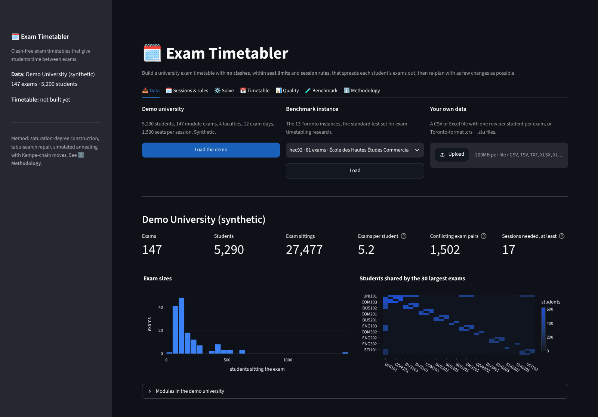
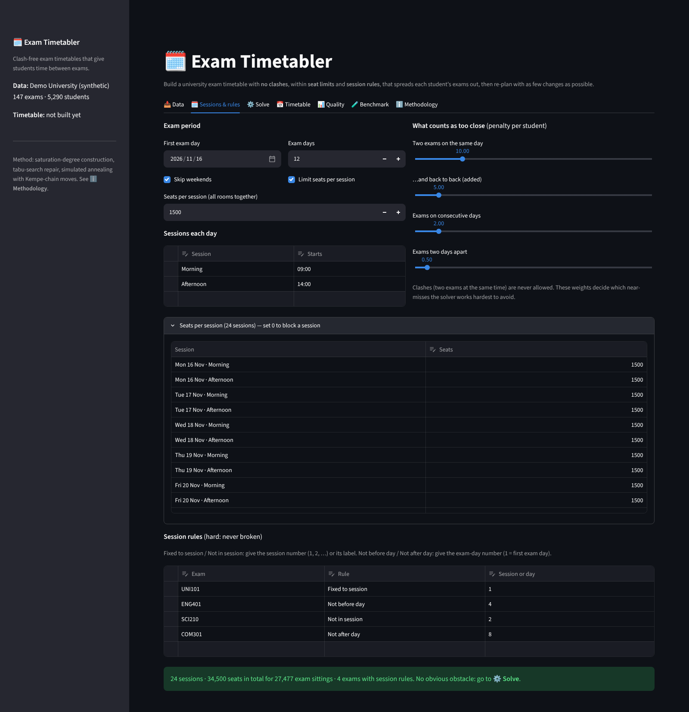
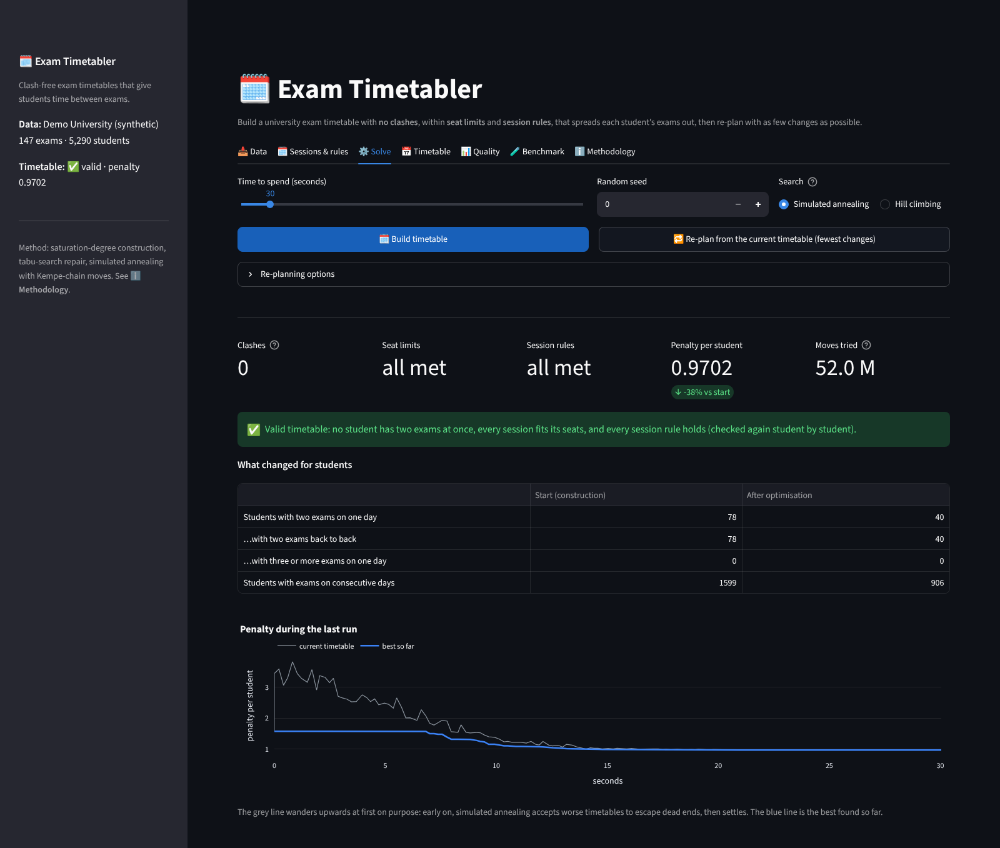
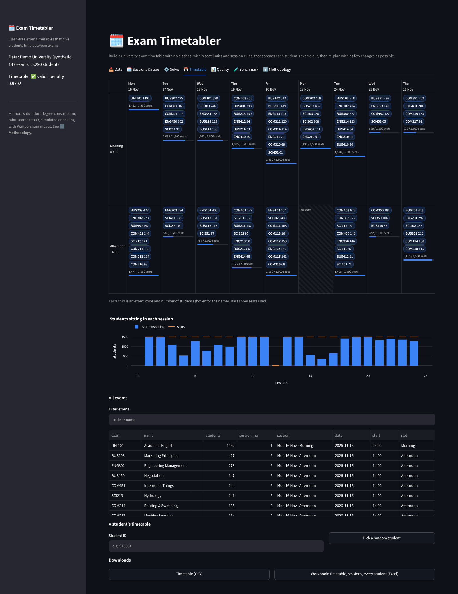
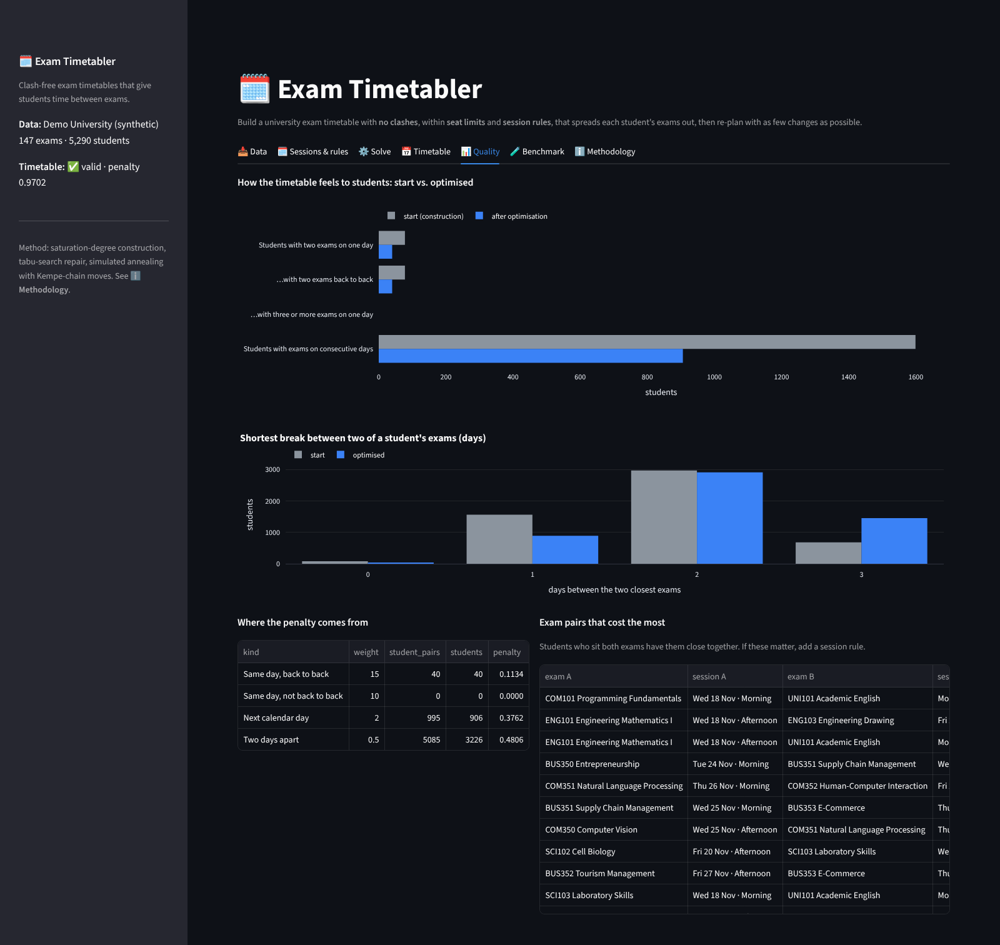
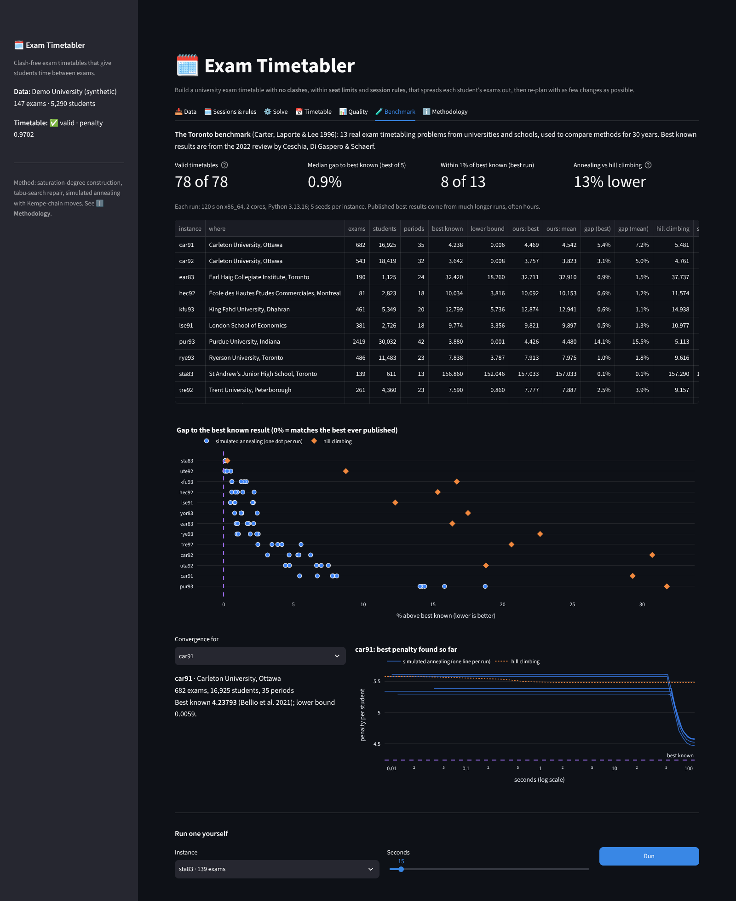
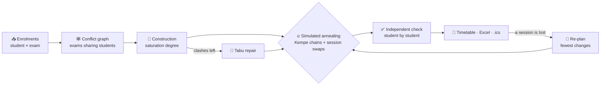

<div align="center">

# 🗓️ Exam Timetabler

**University exam timetables with no clashes, that give every student time between exams.**
Simulated annealing with Kempe chains, seat limits, fixed and blocked sessions, and re-planning with the fewest changes.




</div>

## 🎯 The problem

Every exam period, a university has to give each exam a date and session. Thousands of students take different
combinations of modules, so **two exams that share even one student can never be at the same time**. Halls have a
fixed number of seats, and some exams are fixed or cannot go on certain days. Within those rules, a good timetable
also **spreads each student's exams out**: two exams on the same day, or on consecutive days, is stressful and hurts
results. Done by hand this takes days and still leaves crowded weeks. It is a hard optimisation problem
(graph colouring with extra rules), and the subject of 30 years of research.

## ⚡ Tested on 13 real exam timetabling problems

The solver was run on the **Toronto benchmark**: 13 real exam timetabling problems from universities and schools in
Canada, the US, the UK and Saudi Arabia (81 to 2,419 exams, 611 to 30,032 students), the standard test set in this field. Results are
compared with the **best timetables ever published** for each (Ceschia et al. 2022).



| | Result (120 s per run, 5 runs per instance) |
|---|---|
| ✅ **Valid timetables** (no clashes, checked student by student) | **78** of 78 runs |
| 🎯 **Gap to the best known result** | median **1.5%** (average run), **0.9%** (best run) |
| 🥇 **Within 1% of the best ever published** | 8 of 13 instances (best run) |
| ⛰️ **Simulated annealing vs. plain hill climbing** | 13% lower penalty (median), same time |

> **In plain words:** in two minutes on an ordinary 2-core machine, it comes within 1% of the best timetables ever
> published on 8 of the 13 problems; those records came from research methods running for far longer. The gap is largest
> on the biggest problems: 3–5% on the three with 540–680 exams, and 14% on Purdue's 2,419 exams, which need longer runs.

## 👩‍🎓 What it changes for students

The app comes with a synthetic university to try it on: 5,290 students, 147 module exams, 4 faculties, 12 exam days,
1,500 seats per session, a fixed exam, a lost session and lecturer availability rules.



## 📸 The app

| | |
|---|---|
|  |  |
|  |  |
|  |  |

| Tab | What you do there |
|---|---|
| 📥 **Data** | Load the demo, a benchmark instance, or your own enrolments (CSV / Excel: one row per student per exam; or Toronto .crs + .stu). See how many exams share students and a lower bound on the sessions needed. |
| 🗓️ **Sessions & rules** | Exam days and sessions per day, seats per session (0 blocks a session), how much "same day" or "next day" matters, and hard rules: fixed session, not in a session, not before / after a day. |
| ⚙️ **Solve** | Build the timetable and watch the penalty fall live. After a change (a hall is lost), **re-plan** from the current or a published timetable, moving as few exams as possible. |
| 📅 **Timetable** | Calendar view with seat use, every exam, any student's own timetable with a calendar file (.ics), and downloads (CSV, Excel with a sheet per student sitting). |
| 📊 **Quality** | Students with two exams in a day or on consecutive days, shortest breaks, where the penalty comes from, and the exam pairs that cost the most. |
| 🧪 **Benchmark** | The 13-instance results above, convergence curves, and a live run against the best known result. |

## 🧠 How it works



| Idea | In plain words |
|---|---|
| **Conflict graph** | Exams are points; two exams are linked if a student sits both. Linked exams need different sessions, like neighbouring countries on a map needing different colours. |
| **Saturation degree** | Place first the exam with the fewest sessions still open to it (Brélaz 1979), where it adds the least penalty. If it gets stuck, a tabu search removes the last clashes. |
| **Kempe chain move** | Move an exam from session A to B; any exam in B that shares students with it swaps to A, and so on along the chain. The timetable stays clash-free after every move (Thompson & Dowsland 1998). |
| **Simulated annealing** | Try hundreds of thousands of such moves per second (compiled with Numba), sometimes accepting a worse timetable early on so the search does not get stuck, less and less often over time. |
| **Penalty** | For every student with two exams close together: Toronto standard 16, 8, 4, 2, 1 for 1–5 periods apart; in calendar mode, your weights for same day, back to back, next day, two days. |
| **Re-planning** | Moving an exam away from the published timetable costs a chosen amount per student sitting it, so exams only move when they have to. |

## 🚀 Quick start

```bash
git clone https://github.com/harshadulshan/exam-timetabler.git
cd exam-timetabler
pip install -r requirements.txt
streamlit run app.py
```

Click **Load the demo**, then **⚙️ Solve → Build timetable** (the first run compiles the solver, about 10 s).

**For your own exams:** export enrolments as CSV or Excel with one row per student per exam
(`student_id, module_code[, module_name]`; see `sample_data/demo_enrolments.csv`), set the exam days, sessions and
seats, add any fixed or blocked sessions, and build.

## ✅ Verified

```bash
python tests/verify_engine.py      # 71 checks
python tests/verify_app.py         # 39 checks: runs the app headlessly through every tab
python benchmarks/run_benchmark.py # the 13-instance benchmark (about 80 minutes on 2 cores)
```

- **Finds the true optimum** on small instances: checked against all 390,625 possible timetables.
- **Never breaks a hard rule**: after tens of thousands of high-temperature moves there is no clash, no session over its
  seats and no exam in a blocked session; impossible instances are reported, not faked.
- **Bookkeeping is exact**: the running penalty after thousands of Kempe-chain and session-swap moves equals the penalty
  recomputed from scratch, and the solver's penalty equals a separate student-by-student evaluation.
- **Data**: all 13 instances match the published exam, student and enrolment counts, and every file is checked by MD5
  when it is loaded.
- **Re-planning**: when the demo loses a busy session, only the exams that were in it move (12 of 147 in the test run);
  rebuilding from scratch would have moved 132.
- **Mutation check**: 18 bugs planted one at a time (wrong move cost, chains that skip a session, seat or rule
  checks removed, wrong penalty weights, ...). The tests caught all 18.

## ⚠️ Limitations

- **Seats are counted per session, not per room.** Assigning exams to individual rooms is not included.
- **All sessions have the same length**; exam durations, "A before B" and "A and B at the same time" rules are not modelled
  (fix both to one session for the last).
- **The weights are a policy choice.** How bad "same day" is compared with "next day" differs between universities.
- **The biggest problems** are still 3–14% above the best published results after two minutes; longer runs close part
  of the gap.
- **The demo university is synthetic.** The benchmark instances are real, but from the 1980s and 1990s.

<details>
<summary><b>📂 Project structure, data & references</b></summary>

```
app.py                     Streamlit interface (7 tabs)
timetabler/problem.py      enrolments, conflict graph, sessions, penalties, session rules, lower bounds
timetabler/kernels.py      compiled construction, tabu repair, simulated annealing (Kempe chains, session swaps)
timetabler/solver.py       construct -> repair -> anneal, time budget, progress, re-planning costs
timetabler/evaluate.py     independent student-by-student evaluation, student experience
timetabler/io.py           CSV / Excel enrolments, Toronto .crs / .stu
timetabler/benchmarks.py   the 13 Toronto instances: counts, best known results, lower bounds, download + MD5
timetabler/demo.py         the synthetic demo university
timetabler/export.py       CSV, Excel workbook, student calendar (.ics), timetable re-import
benchmarks/                run_benchmark.py, results.json
sample_data/               demo enrolments (CSV) and 4 benchmark instances for offline tests
tests/                     verify_engine.py, verify_app.py
```

**Data.** Toronto benchmark (Carter, Laporte & Lee 1996), version I, as distributed for research; four small instances
are included, the others download once from a public copy and are checked against MD5 sums. Best known results and lower
bounds as tabulated by Ceschia, Di Gaspero & Schaerf (2022).

- Carter, M. W., Laporte, G., & Lee, S. Y. (1996). Examination timetabling: Algorithmic strategies and applications.
  *Journal of the Operational Research Society*, 47(3), 373–383.
- Ceschia, S., Di Gaspero, L., & Schaerf, A. (2022). Educational timetabling: Problems, benchmarks, and state-of-the-art
  results. arXiv:2201.07525.
- Bellio, R., Ceschia, S., Di Gaspero, L., & Schaerf, A. (2021). Two-stage multi-neighborhood simulated annealing for
  uncapacitated examination timetabling. *Computers & Operations Research*, 132, 105300.
- Thompson, J. M., & Dowsland, K. A. (1998). A robust simulated annealing based examination timetabling system.
  *Computers & Operations Research*, 25(7–8), 637–648.
- Brélaz, D. (1979). New methods to color the vertices of a graph. *Communications of the ACM*, 22(4), 251–256.
- Hertz, A., & de Werra, D. (1987). Using tabu search techniques for graph coloring. *Computing*, 39, 345–351.
- Kirkpatrick, S., Gelatt, C. D., & Vecchi, M. P. (1983). Optimization by simulated annealing. *Science*, 220, 671–680.

</details>

<div align="center">

**Harsha Dulshan** · BSc (Hons) Management Information Systems, NSBM Green University
[GitHub](https://github.com/harshadulshan) · [LinkedIn](https://www.linkedin.com/in/harsha-kaldera/) · MIT License

</div>
